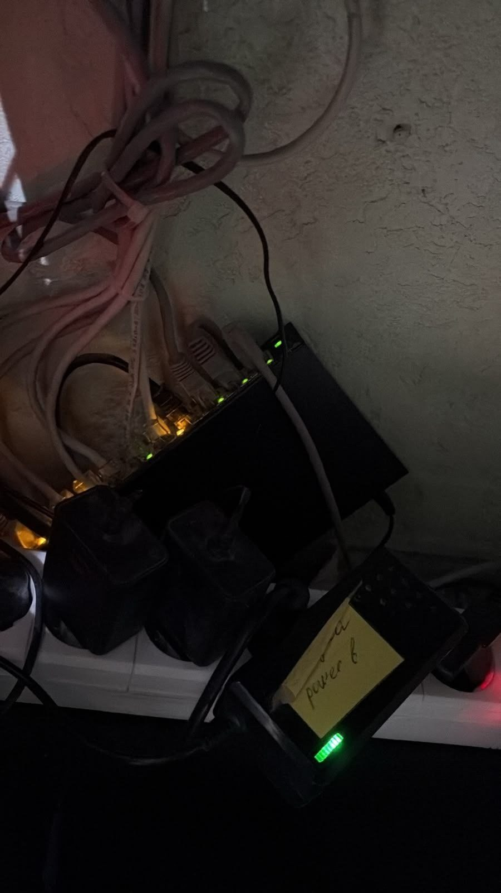

**The Context (Business Challenge / Problem):**
The photo shows a switch in an office, not on a wall or in a rack: it hangs on its patch cords, and the cables carry its weight.

The network was built four years ago. Four days ago one computer started running with interruptions: the link sits at 100 Mbit/s instead of 1 Gbit/s, and about once a day the computer disappears from the network.

Someone moves the switch, and the computer comes back. Not software, not coincidence: the nudge is a clue, not a diagnosis.

The computer runs a database with periodic demand and minimal load. By throughput, 100 Mbit/s is probably enough. The bottleneck is availability: once a day it leaves the network, and a person has to walk over and touch the hardware.

**The Architecture & Work (Solution):**

## Two symptoms, not one

"Slow and dropping" reads as one fault. Check it as two.

**Constant 100 Mbit/s.** 1000BASE-T uses all four pairs, 250 Mbit/s each. 100BASE-TX uses two: pins 1–2 and 3–6; 4–5 and 7–8 are unused. An open or marginal pair in 4–5 or 7–8 does not kill the link. Autonegotiation takes the highest common option: 100 Mbit/s, often unnoticed.

**A daily full loss.** Now the working pairs are involved. Damage in 1–2 or 3–6, or an unstable contact in the port, matches what the user sees: the link vanishes and returns. A link that revives after a nudge is a contact symptom — plug, port, or solder joint. Only an inspection will say which.

One cause can produce both: a plug not fully seated or a connector pulled sideways. Plausible is not proven; check each symptom separately.

## What Constant Load Does

The network is four years old, and age is not the diagnosis: four-year-old cabling holds gigabit. What matters: the cable works as a fastener now, and the connector carries the device. How long — unknown.

The chain: weight holds the contact, the contact heats and oxidizes, resistance grows — hence errors and dropouts. CommScope warns that a tight cord pulls the connector; Fluke explains why the wire with higher resistance fails first.

A nudge changes the contact geometry for all eight wires at once, so the symptom returns immediately.

**An honest caveat about the standards.** I looked for "do not hang equipment on cables" in TIA-568.0-E, TIA/EIA-568-B and switch installation guides. It does not exist. Three requirements exist: minimize tension (TIA-568.0-E, 6.1); let the cable system and rack floor carry the weight (NVIDIA); mount to wall studs or a firmly attached backboard (Cisco). No direct prohibition; together they justify calling the photo a violation. That is an inference, not a quote.

## Mounting Is Not Optional

Mounting is not a "when there is time" job; it is an obligatory condition for long-term network operation. Load on the contacts means daily dropouts and someone hunting for what to nudge. A switch on cables is not a saved bracket; it is deferred downtime.

If people work nearby, coil the cables and run them in a cable tray. A cable underfoot can be caught, pull the power, or bring equipment down. That is not about blame; it is the safety of people and equipment.

## What Is Visible Without a Tester

No tester has touched this cable and no counters have been read. The hypothesis rests on behavior:

1. **Link speed.** 1 Gbit/s expected, 100 Mbit/s actual — visible in the OS.
2. **Nudge test.** Moving the switch restores the link: a mechanical contact, most software causes are out.
3. **Counters.** CRC/FCS, runts, `interface resets`, `rx_crc_errors` — not collected. Link flap means three drops a second; here it is one drop a day, counted separately.
4. **Swap.** A known-good cord, then another port, then another device: minutes, and you know where the problem is.
5. **Measure.** A tester at 0.005 Ω per wire finds the bad contact; continuity only sees opens.
6. **Driver last.** Autonegotiation, offloads, power saving.

As of 25 November 2026 nothing has been replaced: the switch still hangs, cable and connectors untouched. That is the plan, not a result.

## What to Do: Diagnose First

Start with diagnosis, not with replacing everything: link speed, counters, a known-good patch cord, another port. Then mounting and cable. Seven steps once the cause is localized:

1. **Mount it.** Wall studs or a plywood backboard, a rack shelf or DIN rail. Velcro, not overtightened ties.
2. **Relieve the cord.** A service loop, and support the power supply separately.
3. **Replace the patch cord** with a known-good one.
4. **Check the port.** Another port, then another device.
5. **Measure, do not ring out.** 0.005 Ω per wire, not continuity.
6. **Read the counters** before and after: CRC/FCS, runts, `interface resets`.
7. **Re-test.** Link at 1 Gbit/s, no dropouts for a few days.

**My rule:** if four of eight wires pass and 100 Mbit/s covers the task, leave it. That is a decision, not a repair, and only on a stable line; daily dropouts are not covered. Throughput was never the problem.

**The Takeaway (Business Value):**
Clear: 100 Mbit/s instead of gigabit, a daily drop, and a nudge that restores it. That points to a contact in the cable, plug or port, not a provider or driver.

Fix: diagnose, then mount and cable, then re-test. A cable is not a fastener. Ten minutes of checks cost nothing; a database that leaves the network daily costs a person at the switch.

We are not robots: we have eyes and hands, but no time to check daily whether the switch has slipped again. Mounting and a cable tray are how you stop coming back to the same spot.
