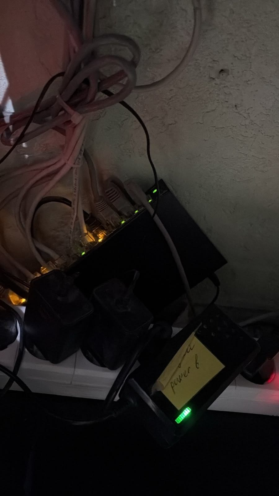

**Контекст (Бизнес-задача / Проблема):**
На фото — небольшой коммутатор в офисе. Он не на стене, не в стойке и не на полке. Он висит на своих патч-кордах, и вес устройства держат кабели.

Сеть построили четыре года назад. Последние четыре дня один компьютер работает с перебоями: линк держится на 100 Мбит/с вместо рабочих 1 Гбит/с, а примерно раз в день компьютер полностью пропадает из сети.

Кто-то подходит и шевелит коммутатор. Компьютер возвращается. Это не программное исправление и не совпадение: линк возвращает механика. Диагностики ещё не было — тестер на кабель не ставили.

На компьютере база данных с периодической востребованностью и минимальной нагрузкой. По пропускной способности 100 Мбит/с ей, скорее всего, хватает. Для этой базы узкое место — доступность, а не пропускная способность: раз в день она выпадает из сети, и каждый раз человеку нужно физически тронуть железо, чтобы вернуть её.

**Архитектура и Реализация (Решение):**

## Два симптома, а не один

Хочется прочитать «медленно и пропадает» как одну неисправность. Проверять надо как две.

**Постоянные 100 Мбит/с.** 1000BASE-T работает по всем четырём парам, по 250 Мбит/с на пару. 100BASE-TX обходится двумя: контакты 1–2 и 3–6, а 4–5 и 7–8 не задействованы. Если пара 4–5 или 7–8 оборвана или держится на грани, линк не падает: автосогласование выбирает лучший общий вариант и садится на 100 Мбит/с. Сеть «работает», и обычно это замечают не сразу.

**Ежедневное полное пропадание.** Здесь задействованы рабочие пары. Повреждение 1–2 или 3–6 либо нестабильный контакт в порту дают ровно то, что замечает пользователь: линк исчезает и возвращается. Линк, который оживает после механического сдвига, — это симптом контакта: в вилке, в порту или в пайке. Какая именно точка виновата, покажет только осмотр.

Одна причина может давать оба симптома. Вилка, вставленная не до щелчка, или коннектор, который вес коммутатора тянет вбок, теряет 4–5 и 7–8 (отсюда 100 Мбит/с) и одновременно держит 1–2 и 3–6 на грани (отсюда ежедневное пропадание). Правдоподобно — не значит доказано. Каждый симптом проверяется отдельно.

## Что делает постоянная нагрузка

Сети четыре года. Возраст — не диагноз: четырёхлетняя кабельная система спокойно держит гигабит. Сейчас кабель работает крепежом, и вес устройства несёт коннектор. Сколько это продолжалось — неизвестно.

Цепочка простая: вес держит контакт, контакт греется и окисляется, растёт сопротивление — отсюда ошибки и обрывы. CommScope предупреждает, что натянутый патч-корд тянет коннектор; Fluke объясняет, почему жила с большим сопротивлением пропадает первой.

Сдвиг меняет геометрию контакта сразу у всех восьми жил — поэтому симптом возвращается мгновенно.

**Честная оговорка про нормы.** Я искал фразу «не подвешивайте оборудование на кабеле» в TIA-568.0-E, TIA/EIA-568-B и монтажных инструкциях нескольких семейств коммутаторов. Такой фразы нет. Есть три требования разного уровня. TIA-568.0-E (п. 6.1) требует минимизировать натяжение в подвешенных участках и перетянутых пучках. Документация NVIDIA для ЦОД: вес кабелей держит кабельная система и пол стойки, а не разъёмы. Cisco: оборудование крепят к стойкам каркаса или к прочно закреплённому щиту. Прямого запрета нет; вместе эти требования дают основание считать подвес нарушением. Это вывод, а не цитата.

## Крепление — не выбор, а обязательное условие

Крепление — не задача «сделаем, когда будет время». Это обязательное условие долгосрочной работы сети. Нагрузка на контакты — это ежедневные обрывы и человек, который ищет, что пошевелить. Коммутатор на кабелях — не экономия на кронштейне, а отложенный простой.

Если рядом люди, кабели бухтуем и убираем в кабель-канал. Провод под ногами — риск задеть, выдернуть питание, уронить оборудование. Это не поиск виноватого, а безопасность людей и оборудования.

## Что видно без тестера

Тестер на кабель не ставили, счётчики на порту не снимали. Версия держится на поведении, и оно уже сузило круг:

1. **Скорость линка.** Ожидается 1 Гбит/с, по факту 100 Мбит/с — видно из операционной системы.
2. **Тест сдвигом.** Шевеление коммутатора возвращает линк: механический контакт, большинство программных причин отпадает.
3. **Счётчики.** CRC/FCS, runts, `interface resets`, `rx_crc_errors` — пока не сняты. Флап — это три падения в секунду; здесь одно пропадание в день, его считают отдельно.
4. **Замена.** Заведомо исправный патч-корд, потом другой порт, потом другое устройство: минуты, и ясно, где проблема.
5. **Измерение.** Тестер с сопротивлением каждой жилы до 0,005 Ом показывает плохой контакт; дешёвый тестер целостности видит только обрыв.
6. **Драйвер последним.** Автосогласование, offload, энергосбережение — после того, как физика исключена.

На 25 ноября 2026 ничего не заменено: коммутатор так и висит, кабель и коннекторы не тронуты. Замена — это план, а не результат.

## Что делать: сначала диагностика

Начинаем с диагностики, а не с замены всего подряд: скорость линка, счётчики, заведомо исправный патч-корд, другой порт. Потом крепление и кабель. Семь шагов, когда причина локализована:

1. **Закрепить коммутатор.** К стойкам каркаса стены или к прочно закреплённому фанерному щиту; полка или кронштейн в стойке; DIN-рейка для промышленных моделей. Липучки вместо перетянутых стяжек.
2. **Разгрузить патч-корд.** Сервисная петля, чтобы коннектор не был точкой натяжения; блок питания разгрузить отдельно.
3. **Заменить патч-корд** на заведомо исправный.
4. **Проверить порт.** Другой порт, потом другое устройство.
5. **Измерить, а не прозвонить.** Тестер с сопротивлением каждой жилы до 0,005 Ом; тестер целостности видит только обрыв.
6. **Снять счётчики** до и после: CRC/FCS, runts, `interface resets`.
7. **Проверить после ремонта.** Линк на 1 Гбит/с, пропаданий нет несколько дней.

**Компромисс на четырёх жилах.** Правило, которым я пользуюсь: если из восьми жил проходят четыре и 100 Мбит/с хватает под задачу — оставить. Это решение, а не ремонт, и только на стабильной линии. Ежедневные пропадания под него не попадают: здесь проблема не в пропускной способности.

**Бизнес-результат (Ценность):**
Что понятно: линк упал до 100 Мбит/с, раз в день пропадает, сдвиг возвращает связь. По симптомам это контакт в кабеле, разъёме или порту — не провайдер и не драйвер.

Что сделать: диагностика, потом крепление и кабель, потом повторный тест. Кабель — не крепёж. Десять минут проверки не стоят ничего; база, которая каждый день уходит из сети, стоит человека у коммутатора.

Мы не роботы, мы люди: глаза и руки есть, а времени каждый день проверять, не отвалился ли коммутатор, — нет. Крепление и кабель-канал — способ не возвращаться к одному и тому же месту.
