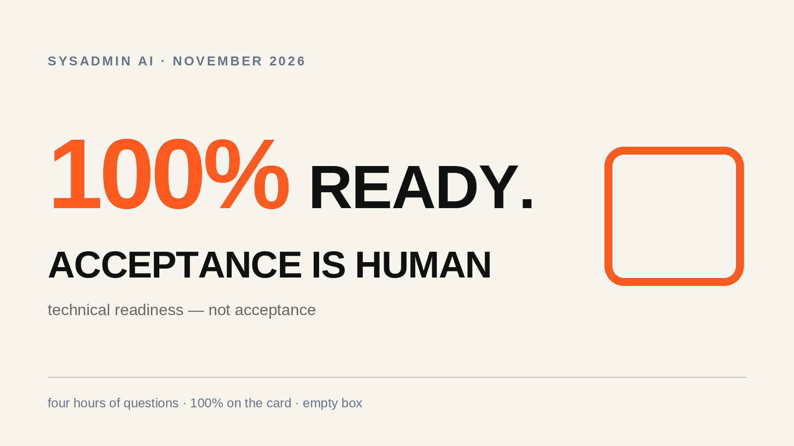
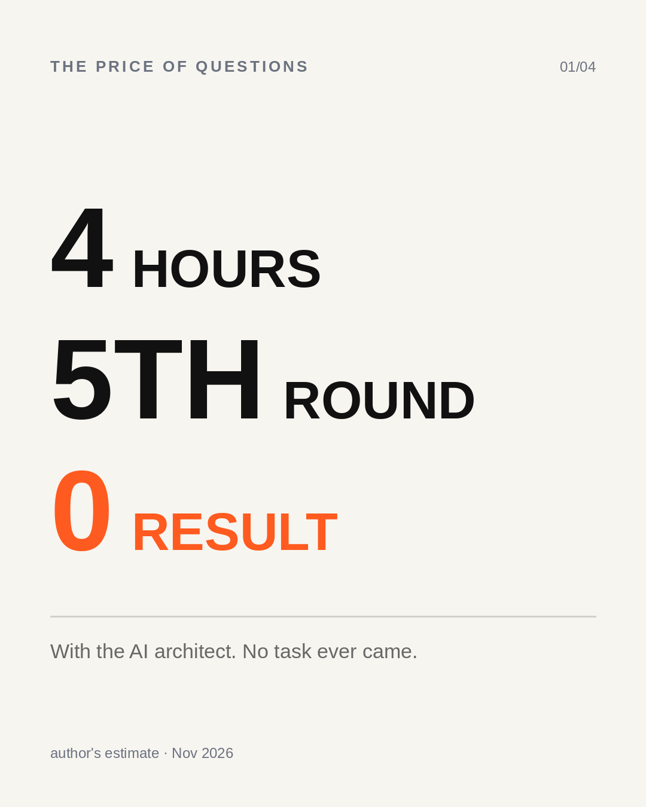
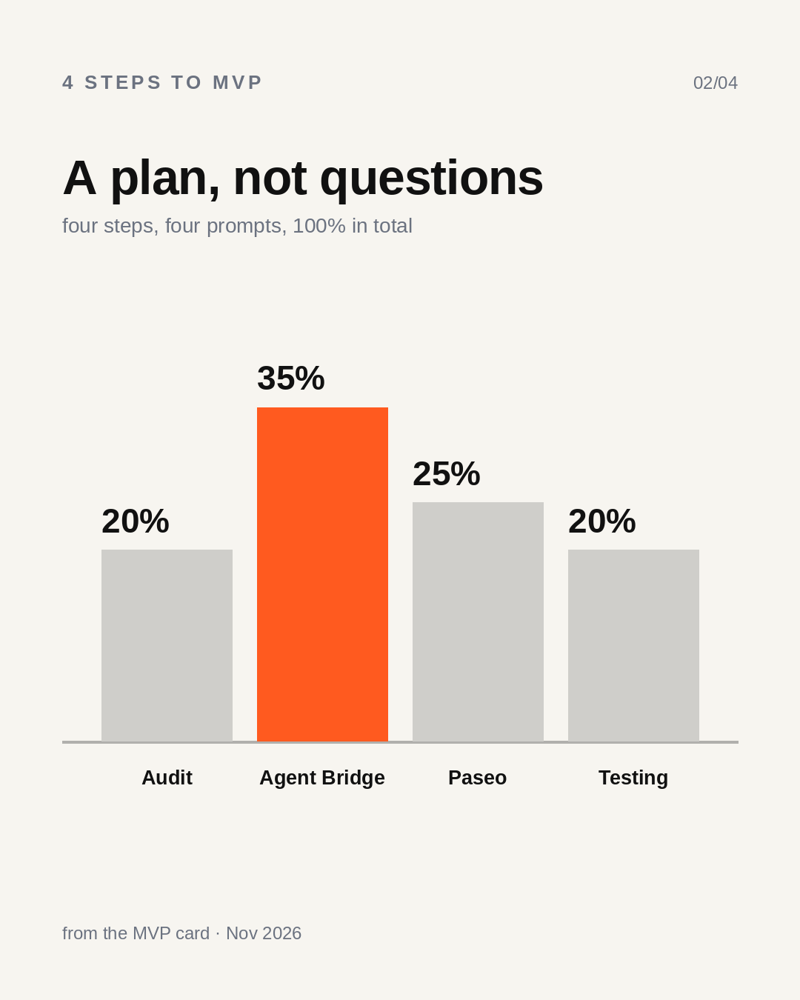
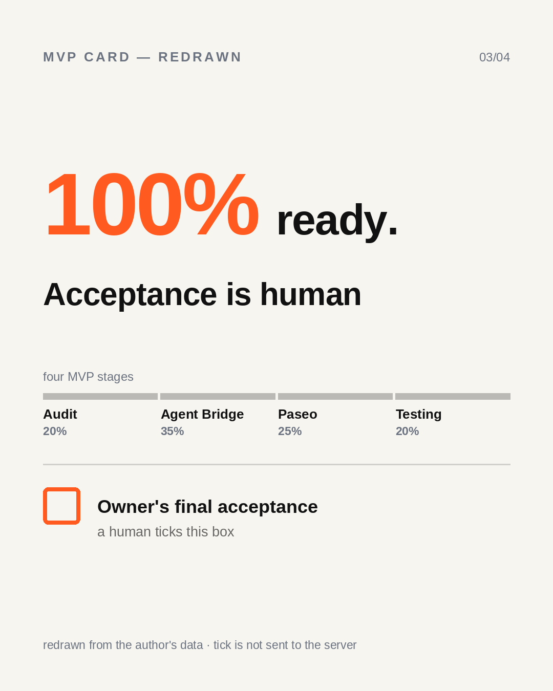
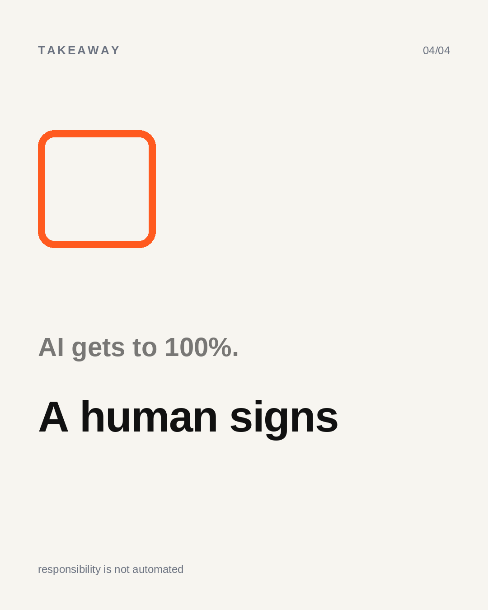

**The Context (Business Challenge / Problem):**
I needed an architecture for a multi-agent system. I handed the job to an AI architect and spent about four hours with it.

The conversation went in circles. The architect asked questions — by the fifth round of six questions, the conversation had not moved. After every answer the same line appeared at the bottom: send these answers, and the task will follow. The task never came. What came was another round of questions and another layer of complexity.

Four hours in, I had nothing: no plan, no working system, no clear entry point. I simply could not get anything done with it. My nerves gave out.

This is not a story about a bad model. The questions were on point. The problem was the format. I was kept in clarification mode while nobody started the work. Four hours is an evening I do not get back.

**The Architecture & Work (Solution):**

## Plan Mode Instead of Another Round

I stopped building through the architect and moved Sysadmin into Plan mode. The job changed: instead of answering questions, the system had to lay out a plan. In normal mode it answers a question; in Plan mode it lays the work out in steps and then executes them.

We discussed the simplest possible MVP — no diagram with ten services. The model: DeepSeek 4.1 Flash. The plan came out as four steps with weights: audit 20%, build and deploy the Universal Agent Bridge 35%, integration with Paseo 25%, testing and recovery 20%. That adds up to 100%.

## Four Steps, Four Prompts

**Audit — 20%.** Collect real data and map how the tools and systems connect. This is the step that is easy to skip: starting an integration before knowing what connects to what. After the audit came six or seven questions, the useful kind, not a survey of goals and values.

**Universal Agent Bridge — 35%.** The bridge that keeps a multi-agent session alive. The heaviest part by weight, and that is fair: nothing else works without it.

**Paseo — 25%.** Integration. Paseo runs. This article was written in a Creative Teams chat, which is a working example, not a promise.

**Testing and recovery — 20%.** Prove that a session survives a failure and continues where it stopped instead of starting over.

One detailed prompt per step. Four steps, four prompts. From there the work moves step by step: the system runs one, shows the result, takes the next.

## Where It Broke: Sub-agents and Sessions

The real failure was not in the code. Sub-agents run inside the agent, and when one of them fell over, the whole session died. It did not resume from the failure point; it closed. The session had to start over.

That is why the bridge exists as a separate layer. And why the work sits in its own LXC container on Proxmox: isolation, so an experiment does not take the production loop down with it. Part of the behaviour is still under test, so I will not claim every cause is known. One thing is clear already: a multi-agent system without session recovery is a demo, not a tool.

## What Ready Looks Like

The card below is a reconstruction from the author's data, not a screenshot of the interface. It reads 100% and "Ready for acceptance". Under it, four stages, each with its weight. Under those, a separate line: "Final acceptance by the owner". It is empty.

The interface says outright that the mark is manual and is not sent to the server. That is not a forgotten button or a bug. It is the boundary. Everything that could be automated was automated, and the last action stayed with a person.

100% on screen means technical readiness for acceptance, not a finished product. The difference is who answers for it.



  
  
  
  
  



**The Takeaway (Business Value):**
About four hours went into arguing with the architect and nothing into the result. After the switch to Plan mode, the MVP moved through four steps and reached 100% technical readiness.

The conclusion is simple and uncomfortable for both sides: AI takes the work to 100%, but the responsibility for those 100% stays human. Not because the system failed. Because acceptance is not a checkbox review; it is a decision to carry the risk.

Look at your own process. Find the place where something reads "100% ready" and nobody has signed it off. If there is no such place, good. If there is, that is where the difference between a demo and a working system lives.
