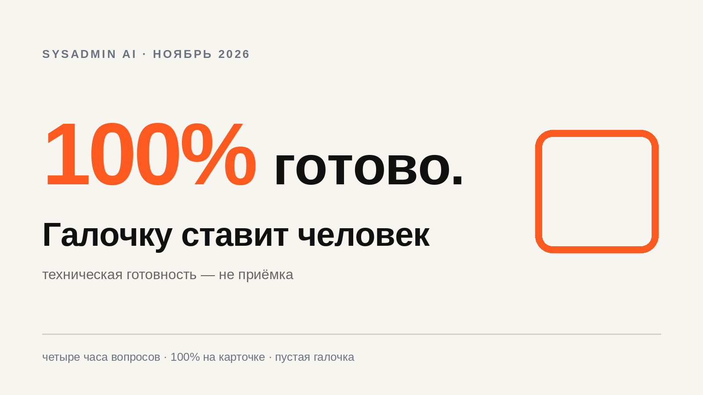
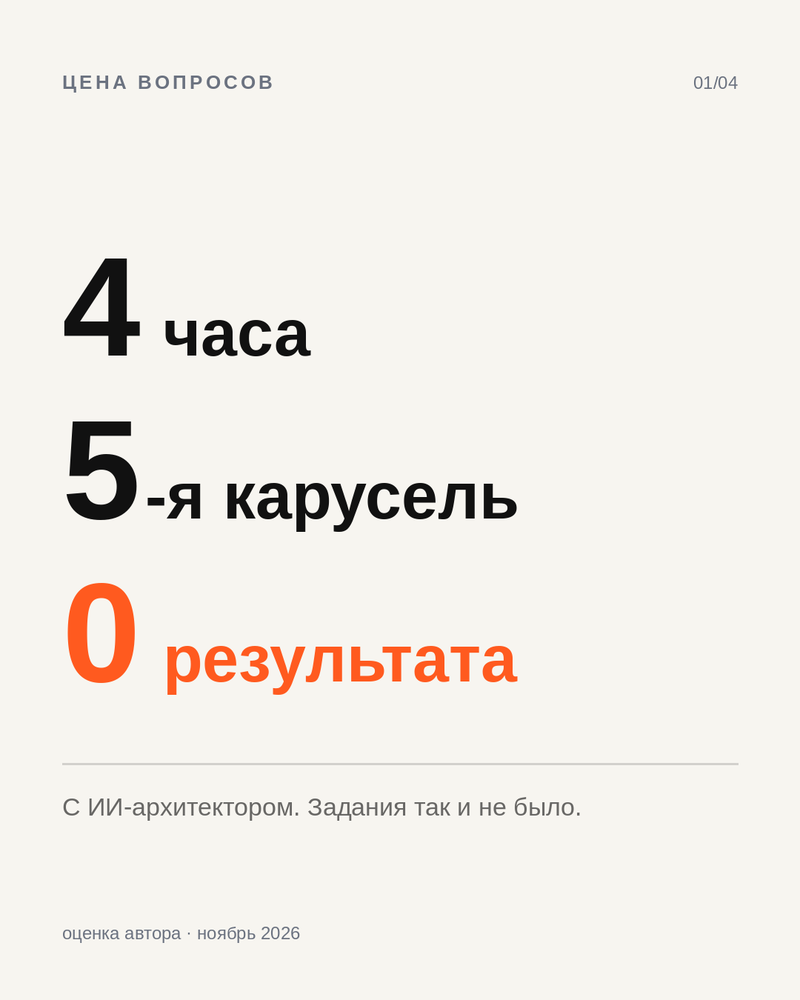
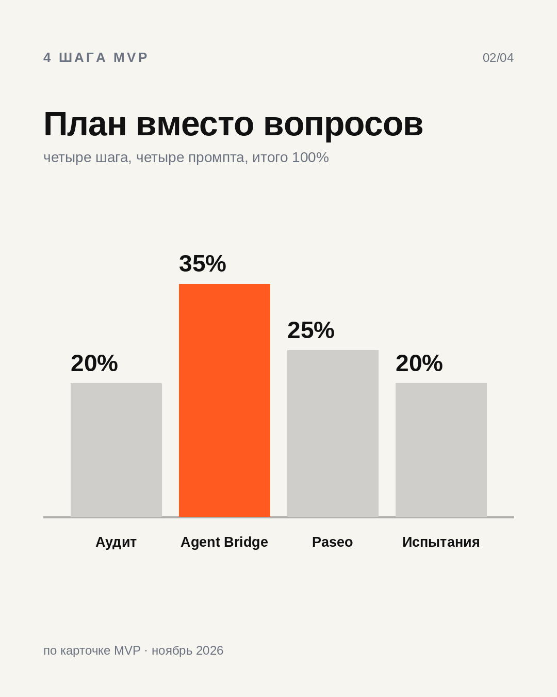
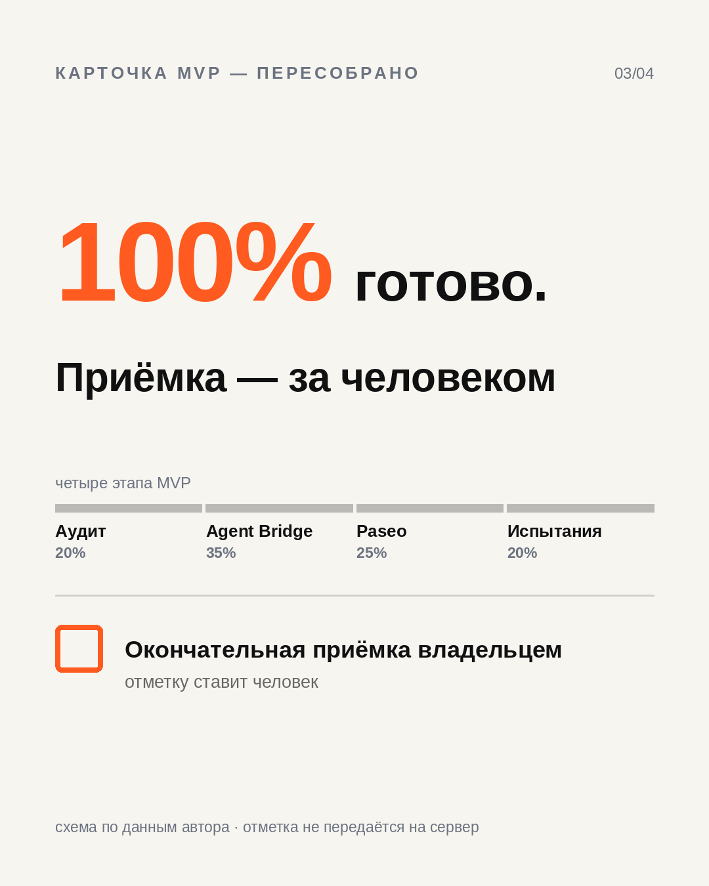
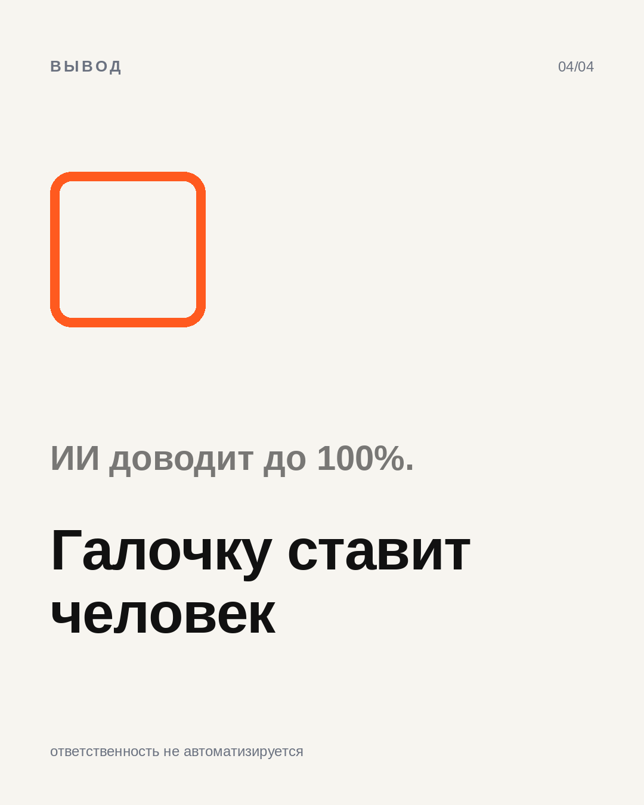

**Контекст (Бизнес-задача / Проблема):**
Мне нужна была архитектура мультиагентной системы. Я отдал эту работу ИИ-архитектору и провёл с ним около четырёх часов.

Разговор шёл по кругу. Архитектор задавал вопросы — к пятой карусели по шесть вопросов разговор не сдвинулся. После каждого моего ответа внизу появлялась одна и та же строка: ему осталось получить ответы — и он выдаст задание. Задания не было. Вместо него — новая порция вопросов и ещё один слой усложнения.

К концу четвёртого часа у меня было ноль результата: ни плана, ни работающей системы, ни понятной точки входа. Я просто не смог ничего с ним сделать. Нервы сдали.

Это не история про плохую модель. Вопросы были по делу. Проблема была в формате: меня держали в режиме уточнений, а работу никто не начинал. Четыре часа — это вечер, который не вернуть.

**Архитектура и Реализация (Решение):**

## Режим «План» вместо очередной карусели

Я перестал строить через архитектора и переключил Sysadmin в режим «План». Задача сменилась: вместо ответов на вопросы — план и шаги. Обычный режим отвечает на вопрос, режим «План» сначала раскладывает работу на шаги, а потом их выполняет.

Мы обсудили самый простой вариант MVP — без схемы на десять сервисов. Модель — DeepSeek 4.1 Flash. План вышел из четырёх шагов с весами: аудит 20%, разработка и развёртывание Universal Agent Bridge 35%, интеграция с Paseo 25%, испытания и восстановление 20%. В сумме 100%.

## Четыре шага, четыре промпта

**Аудит — 20%.** Собрать реальные данные и понять, как связать программы и системы между собой. Этот шаг легко пропустить: начать интеграцию, не зная, что с чем соединяют. После аудита появились шесть-семь вопросов — по делу, а не про цели и ценности.

**Universal Agent Bridge — 35%.** Мост, который держит мультиагентную сессию. Самая тяжёлая часть по весу, и это честно: без неё остальное не работает.

**Paseo — 25%.** Интеграция. Paseo работает: этот текст собран в чате Creative Teams. Рабочий пример, а не обещание.

**Испытания и восстановление — 20%.** Проверить, что сессия переживает сбой и продолжается с того места, где остановилась, а не начинается заново.

На каждый шаг — подробный промпт. Четыре шага, четыре промпта. Дальше работа идёт по шагам: система выполняет шаг, показывает результат, берётся за следующий.

## Где ломалось: подагенты и сессия

Главная поломка была не в коде. Внутри агента работают подагенты, и когда один из них падал, валилась вся сессия. Она не продолжалась с места сбоя — закрывалась. Сессию приходилось начинать заново.

Поэтому и понадобился отдельный слой — Universal Agent Bridge. И отдельный LXC-контейнер на Proxmox: изоляция, чтобы эксперимент не уносил с собой рабочий контур. Часть поведения я ещё проверяю, поэтому не утверждаю, что все причины установлены. Одно видно уже сейчас: мультиагентная система без восстановления сессии — это демо, а не инструмент.

## Как выглядит готовность

Ниже — схема по данным автора, не скриншот интерфейса. На ней 100% и статус «Готово к приёмке». Дальше четыре этапа, у каждого свой вес. И отдельная строка — «Окончательная приёмка владельцем». Она пустая.

В интерфейсе прямо написано, что отметка ручная и на сервер не передаётся. Это не забытая кнопка и не баг. Это граница: всё, что можно было автоматизировать, автоматизировано; последнее действие осталось человеку.

100% на экране — это техническая готовность к приёмке, а не готовый продукт. Разница в том, кто за него отвечает.



  
  
  
  
  



**Бизнес-результат (Ценность):**
Около четырёх часов ушло на попытку договориться с архитектором — и ноль на результат. После переключения в режим «План» MVP прошёл четыре шага и дошёл до 100% технической готовности.

Вывод простой и неудобный для обеих сторон: ИИ доводит работу до 100%, но ответственность за эти 100% остаётся на человеке. Не потому, что система не справилась. Потому, что приёмка — это не проверка галочек, а решение принять риск на себя.

Для заказчика это ещё и вопрос доверия. Система, которая сама себя принимает, — это система без владельца. Пока галочку ставит человек, у результата есть имя и адрес.

Проверьте свой процесс. Найдите место, где у вас стоит «100% готово», а подписи нет. Если такого места нет — хорошо. Если есть — там и живёт разница между демонстрацией и работающей системой.
